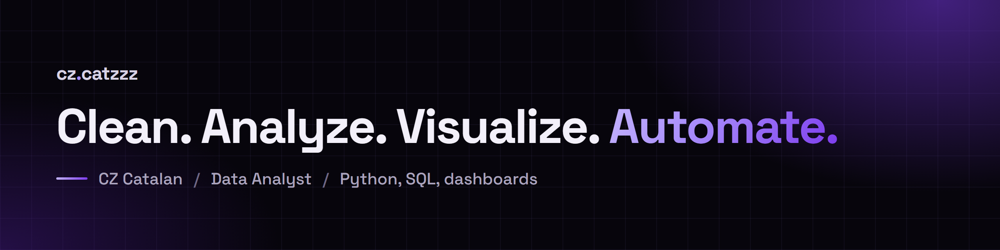

### Hi, I'm CZ.

I'm a data analyst with an engineering background and a soft spot for messy
data. I clean it, report on it, build dashboards from it, and automate the
repetitive parts with Python and SQL. Based in Cagayan de Oro, Philippines.

## What I build

- **Automation tools.** Python desktop tools that search, convert, reconcile,
  and report on CRM data, so hours of manual work become minutes.
- **Dashboards and reporting.** Zoho Analytics dashboards and a call tracking
  dashboard fed by two phone systems through Google Apps Script.
- **Data studies.** Public datasets taken apart, with the method, the charts,
  and the data to download.

## Featured

<table>
  <tr>
    <td width="50%">
      
    </td>
    <td width="50%">
      
    </td>
  </tr>
  <tr>
    <td valign="top">
      <b><a href="https://chimcatz.github.io/cz-portfolio-site/projects/">Projects</a></b> 
      Case studies of the tools and dashboards, each with the problem, the approach, and the results.
    </td>
    <td valign="top">
      <b><a href="https://chimcatz.github.io/cz-portfolio-site/projects/search-and-filter-engine/">A search engine you can try</a></b> 
      Search 50,000 made-up lead records in your browser, in about a millisecond.
    </td>
  </tr>
</table>

More to open:

- [Live dashboards](https://chimcatz.github.io/cz-portfolio-site/projects/database-management-dashboard/), embedded and interactive, on sample data
- [Too Many Applicants, Too Few Jobs, and How to Win](https://chimcatz.github.io/cz-portfolio-site/insights/too-many-applicants-too-few-jobs-and-how-to-win/), a data story built from open government data
- [Data studies](https://chimcatz.github.io/cz-portfolio-site/data-studies/) on Netflix genres, Pokémon stats, and lead conversion
- [The code behind the site](https://github.com/ChimCatz/cz-portfolio-site), an Astro site with three dependencies

## Tool stack

**Languages** 

**Data and reporting** 

**CRM and web analytics** 

**AI and workflow** 

## Contributions

<picture>
  <source media="(prefers-color-scheme: dark)" srcset="https://raw.githubusercontent.com/ChimCatz/ChimCatz/output/snake-dark.svg" />
  <source media="(prefers-color-scheme: light)" srcset="https://raw.githubusercontent.com/ChimCatz/ChimCatz/output/snake.svg" />
  
</picture>

Updated every day by a GitHub Action in this repo. Product names are trademarks of their owners and are listed only to show the tools I use.
